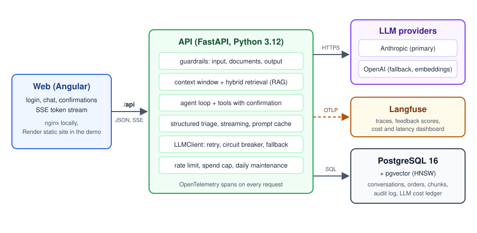

# Atlas — AI customer support agent

**A customer support agent built from first principles: 14 phases, each one a real problem, the
concept that fixes it, and a measured before/after.**

Atlas answers customers of a fictional subscription store in English and Portuguese. It
remembers the conversation, searches a knowledge base, cancels orders and issues refunds through
tools that ask for confirmation, streams its answers, blocks prompt injection, survives provider
outages and is covered by evals and traces. Every part is built from primitives (direct LLM API
calls, PostgreSQL full-text search, embeddings, pgvector, an agent loop of our own) so no
framework hides the moving parts.


## Live demo

Try it at **<https://atlas-web.onrender.com>** and sign in with one of the
[test accounts](#test-accounts). The Operator confirms this URL after each deploy of
[`render.yaml`](render.yaml); the free instance sleeps when idle, so the first request can take
up to a minute.

The public demo runs with fixed limits so it stays cheap and safe to share:

- **Rate limit:** 20 messages per hour per account (`ATLAS_RATE_LIMIT_PER_HOUR`); the chat tells
  you when you can send again.
- **Spend cap:** US$ 2 per day of estimated LLM cost for the whole demo
  (`ATLAS_DAILY_SPEND_CAP_USD`); after that the chat says the demo is back at 00:00 UTC. The cap
  is checked at the start of each request: a request that starts below the cap finishes its
  agent loop, so the day's spend can exceed the cap by at most about (concurrent requests ×
  `ATLAS_AGENT_MAX_COST_USD`, US$ 0.25 per agent run).
- **Daily restore:** once a day the personas' conversations, orders, subscription and refunds
  are reset, so cancellations and refunds made by earlier visitors disappear.
- **Retention:** conversations, audit records and traces are purged after 7 days
  (`ATLAS_RETENTION_DAYS`).
- **No fault injection:** `CHAOS_RATE` is fixed at `0`.
- **Knowledge base:** the API ingests `corpus/` on every boot (`ATLAS_INGEST_ON_BOOT=true` in
  `render.yaml`), so a fresh deploy answers from the store's documents with no manual step.
  Ingestion skips unchanged documents and computes the embeddings with `OPENAI_API_KEY`; a
  failed document is logged and never blocks the start.
- Every visitor shares the same personas, so you may see orders another visitor just cancelled.
  Do not type real personal data.

## Test accounts

Both personas are fictional customers with their own orders, subscription and refunds.

| Username | Language | Customer |
|---|---|---|
| `alex` | English | Alex Morgan |
| `bia` | Portuguese | Bia Souza |

- **Public demo:** the shared password is the one the Operator sets in `ATLAS_PERSONA_PASSWORD`
  and publishes next to the demo link.
- **Local run:** the default password is `atlas-demo` (`ATLAS_PERSONA_PASSWORD` in
  `.env.example`).

Things to try: "Where is my last order?", "Cancel my most recent order", "How do I end my
subscription?" or, as `bia`, the same questions in Portuguese.

## Phases

Each phase starts from a problem the previous version had, adds one concept, and records the
result in [docs/results.md](docs/results.md). The tag of each phase is the repository exactly as
it was when that phase shipped; the ADR explains the decision.

| Phase | Problem | Concept | Result | Tag |
|---|---|---|---|---|
| 01 | The agent cannot even talk to a model behind a stable interface | Direct LLM API call behind our own `LLMClient` ([ADR](docs/adr/0001-llm-api-call.md)) | Name recalled on a 2nd independent call: en no, pt no (the problem phase 02 fixes) | [phase-01](https://github.com/rubensrudio/ai-support/tree/phase-01) |
| 02 | Every message is a new conversation, so the agent forgets the user's name | Persisted history with a summarised context window ([ADR](docs/adr/0002-context-window.md)) | See docs/results.md | [phase-02](https://github.com/rubensrudio/ai-support/tree/phase-02) |
| 03 | The model invents store policies it was never told | RAG with PostgreSQL full-text search and citations ([ADR](docs/adr/0003-rag-full-text.md)) | LLM-judged hallucination rate on 30 questions: 0% without RAG, 7% with full-text RAG (en and pt); synonym queries still miss | [phase-03](https://github.com/rubensrudio/ai-support/tree/phase-03) |
| 04 | Full-text search misses synonyms ("cancel plan" vs "end subscription") | Embeddings with brute-force cosine search ([ADR](docs/adr/0004-embeddings.md)) | See docs/results.md | [phase-04](https://github.com/rubensrudio/ai-support/tree/phase-04) |
| 05 | Brute-force vector search does not scale to a million vectors | pgvector HNSW index and hybrid search with RRF ([ADR](docs/adr/0005-vector-database.md)) | See docs/results.md | [phase-05](https://github.com/rubensrudio/ai-support/tree/phase-05) |
| 06 | The agent can explain how to cancel an order but cannot do it | Tool calling with session identity, UI confirmation and audit ([ADR](docs/adr/0006-tool-calling.md)) | See docs/results.md | [phase-06](https://github.com/rubensrudio/ai-support/tree/phase-06) |
| 07 | One tool call per answer cannot solve multi-step requests | Our own agent loop with step, cost and repeated-call limits ([ADR](docs/adr/0007-agent-loop.md)) | See docs/results.md | [phase-07](https://github.com/rubensrudio/ai-support/tree/phase-07) |
| 08 | Free-text triage output breaks the code that parses it | Native structured output, Pydantic validation and repair ([ADR](docs/adr/0008-structured-output.md)) | See docs/results.md | [phase-08](https://github.com/rubensrudio/ai-support/tree/phase-08) |
| 09 | The customer stares at a spinner until the whole answer is ready | SSE streaming with typed events and cancellation ([ADR](docs/adr/0009-streaming.md)) | See docs/results.md | [phase-09](https://github.com/rubensrudio/ai-support/tree/phase-09) |
| 10 | Prompt injection and personal data leak through the chat | Layered, fail-closed guardrails ([ADR](docs/adr/0010-guardrails.md)) | See docs/results.md | [phase-10](https://github.com/rubensrudio/ai-support/tree/phase-10) |
| 11 | Every turn pays again for the same long system prompt | Cache-ordered prompt layout with one breakpoint ([ADR](docs/adr/0011-prompt-cache.md)) | See docs/results.md | [phase-11](https://github.com/rubensrudio/ai-support/tree/phase-11) |
| 12 | A provider outage takes the whole chat down | Retry, circuit breaker and fallback to a second provider ([ADR](docs/adr/0012-retry-fallback.md)) | See docs/results.md | [phase-12](https://github.com/rubensrudio/ai-support/tree/phase-12) |
| 13 | A prompt change can silently make answers worse | Eval suite with a merge gate against the default branch ([ADR](docs/adr/0013-evals.md)) | See docs/results.md | [phase-13](https://github.com/rubensrudio/ai-support/tree/phase-13) |
| 14 | Nobody can see why one answer was slow, expensive or wrong | OpenTelemetry traces in Langfuse, feedback scores, trace-to-eval loop ([ADR](docs/adr/0014-observability.md)) | See docs/results.md | [phase-14](https://github.com/rubensrudio/ai-support/tree/phase-14) |

"See docs/results.md" means the phase's demo has not been run with the real provider yet; its
row is filled by the demo script, never by hand.

## Architecture



- **Web:** an Angular app (login, chat, tool confirmations, feedback) that reads the answer as a
  server-sent event stream. Locally nginx serves it and proxies `/api/` to the API; in the
  public demo a Render static site rewrites `/api/*` to the API, so the session cookie stays on
  one origin.
- **API:** FastAPI on Python 3.12. A chat turn goes through the input guardrail, the bounded
  context window, hybrid retrieval (full-text plus HNSW, fused with Reciprocal Rank Fusion), the
  agent loop and its tools, and the output guardrail. Destructive tools (cancel, refund) only run
  after the customer confirms in the UI, and every tool call is audited.
- **PostgreSQL 16 with pgvector:** conversations, the store data, knowledge base chunks and their
  embeddings, the audit log and the ledger of LLM costs that enforces the daily spend cap.
- **LLM providers:** every call goes through one `LLMClient` interface. Anthropic is the primary
  model; on errors the client retries, opens a circuit breaker per provider and falls back to the
  secondary model before the first token. OpenAI also computes the embeddings.
- **Langfuse:** each request is an OpenTelemetry trace exported over OTLP, with token, cost and
  latency attributes and the customer's feedback as a score
  ([docs/observability.md](docs/observability.md)). The local stack is self-hosted; the public
  demo uses Langfuse Cloud.

## Quickstart

Requirements: Docker with Compose v2.

```bash
cp .env.example .env
# Edit .env and fill the variables listed in "Required configuration" below.
docker compose up
```

Then open <http://localhost:8080> and sign in as `alex` or `bia`. The API is also published on
<http://localhost:8000> (`GET /health`). On start the `api` container applies the database
migrations (`alembic upgrade head`) and seeds the personas before serving.

| Service | Image | Port | Role |
|---|---|---|---|
| `db` | `pgvector/pgvector:pg16` | 5432 | PostgreSQL with pgvector |
| `api` | `Dockerfile` | 8000 | FastAPI app; migrates and seeds the database on start |
| `web` | `web/Dockerfile` | 8080 | Angular build on nginx; proxies `/api/` to `api` |

Load the knowledge base once (and again after editing `corpus/`):

```bash
docker compose exec api python -m ingest run
```

Tracing is optional. The self-hosted Langfuse stack lives behind the `observability` profile, so
a plain `docker compose up` never starts it:

```bash
docker compose --profile observability up -d
```

See [docs/observability.md](docs/observability.md) for its local login and the variables that
point the API at it.

### Required configuration

Every setting lives in `.env` (template: `.env.example`) and is read by `api/config.py`. The
variables below have no safe default, so `.env.example` leaves them empty. Secrets are never
logged and never committed: `.env` is git-ignored and excluded from the Docker images.

| Variable | Needed for | Notes |
|---|---|---|
| `ANTHROPIC_API_KEY` | chat with `ATLAS_LLM_PROVIDER=anthropic` | Secret. Primary LLM provider. |
| `OPENAI_API_KEY` | embeddings and the secondary (fallback) model | Secret. |
| `ATLAS_PRIMARY_MODEL` | chat with `ATLAS_LLM_PROVIDER=anthropic` | Model id of the primary LLM. Required. |
| `ATLAS_SECONDARY_MODEL` | fallback when the primary provider fails | Model id. |
| `ATLAS_GUARDRAIL_MODEL` | input and output guardrails | Model id. |
| `ATLAS_JUDGE_MODEL` | LLM-as-judge evals | Model id. |
| `ATLAS_OPERATOR_API_KEY` | operator access to triage (`X-Operator-Key` header) | Secret. Empty disables operator access. |
| `LANGFUSE_HOST` | tracing (optional `observability` profile) | URL of the Langfuse server. |
| `LANGFUSE_PUBLIC_KEY` | tracing | Secret. |
| `LANGFUSE_SECRET_KEY` | tracing | Secret. |
| `ATLAS_QA_USERNAME` | automated screen QA | A demo persona username. |
| `ATLAS_QA_PASSWORD` | automated screen QA | Secret. The persona password. |

Every model id you configure needs a price entry in `config/pricing.json`; cost is never assumed
to be zero. To run everything offline (tests, smoke evals, demos with `--provider fake`), set
`ATLAS_LLM_PROVIDER=fake` and `ATLAS_EMBEDDING_PROVIDER=fake`; no key is needed then. The
default retrieval mode is `hybrid`, which embeds every question: with
`ATLAS_EMBEDDING_PROVIDER=openai` and no `OPENAI_API_KEY`, the chat answers that the knowledge
base is unavailable. Use the fake embedder or `ATLAS_RETRIEVAL_MODE=fulltext` without a key.

`ATLAS_LLM_PROVIDER` also accepts `claude_cli` and `codex_cli`, which run through a logged-in
Claude Code or Codex CLI subscription for local manual testing only: their cost is not measured,
prompt caching cannot be controlled and tool calling is not supported, so never use them in CI,
for `docs/results.md` numbers or in the public demo ([ADR 0001](docs/adr/0001-llm-api-call.md)).

### Development, tests, evals and demos

Requirements: `uv`, Node.js 24, Docker.

```bash
uv sync                      # Python dependencies (runtime + dev)
docker compose up -d db      # PostgreSQL for the integration tests
(cd web && npm ci)           # web dependencies
```

Quality gates, from the repository root (integration tests create and drop their own
`atlas_test_<uuid>` database on the compose Postgres):

```bash
uv run ruff check . --output-format=concise
uv run ruff format --check .
uv run mypy
uv run pytest -q             # JUnit report in reports/junit.xml
```

From `web/`:

```bash
npx ng lint
npx tsc --noEmit -p tsconfig.app.json
npx ng test --watch=false    # JUnit report in web/reports/junit.xml
npx ng build
```

Evals are JSONL files in `evals/datasets/`. Run a dataset against a target and write the report
(exit code 0 means the run completed, 2 an execution error):

```bash
uv run python -m evals run --dataset evals/datasets/smoke.jsonl --target echo --out reports/eval-smoke.json
```

CI (`.github/workflows/ci.yml`) runs the gates and the smoke evals on every push and pull request;
`evals.yml` runs the full suite and blocks a merge that drops the score by more than 2 points.

Every phase has a demo script that reproduces its problem and measures the fix. Run it offline
with the fake provider, or with the configured provider to update its row in `docs/results.md`:

```bash
uv run python -m demos.demo_01_stateless --provider fake --results /tmp/results.md  # offline
uv run python -m demos.demo_09_streaming --provider real    # configured provider
uv run python scripts/check_phase.py 09                     # eval cases, demo, results row, ADR
```

## Results

All before/after measurements live in [docs/results.md](docs/results.md), one row per phase,
written by each phase's demo script.

Streaming (phase 09) compares `POST /chat` with `POST /chat/stream`:

- TTFT and total time (p50/p95): not measured yet, see the `09` row of docs/results.md (demo_09).
- Measure them with `uv run python -m demos.demo_09_streaming --provider real`, which writes
  that row.

Architecture decisions are recorded as ADRs in [docs/adr/](docs/adr/); new ones start from
[docs/adr/0000-template.md](docs/adr/0000-template.md).
